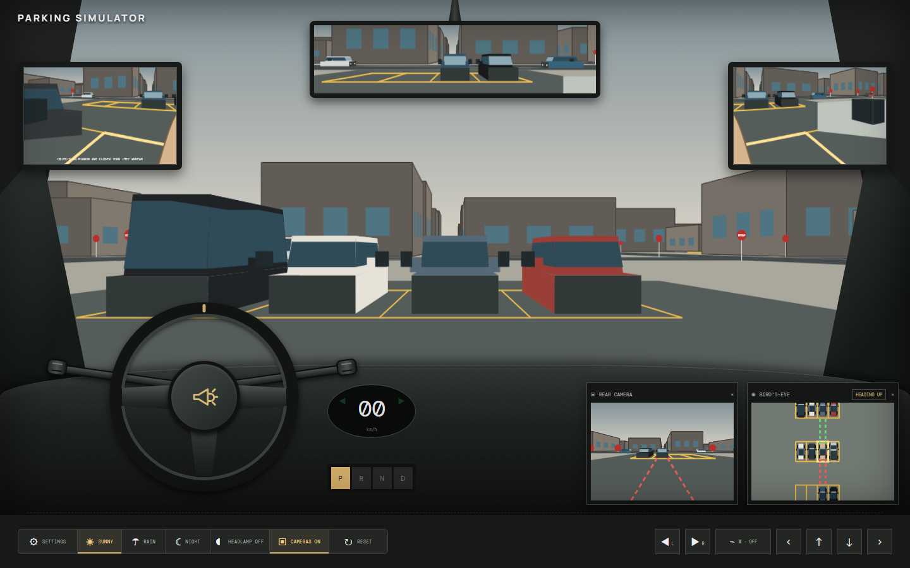

# Parking Simulator

Practice parking from the driver's seat, with mirrors and camera views to help
you judge your position and clearance.

## Version 2 — PrecisionPark 3D

[Play version 2](https://chris-kc-cheng.github.io/parking-simulator/v2/)

Take on a scored back-in parking challenge in a 3D parking lot. Switch between
the driver cockpit and exterior view, and use the mirrors, backup camera,
bird's-eye view and sonar to line up your car. The car stays level when
accelerating or reversing.

## Version 1 — City driving

[Play version 1](https://chris-kc-cheng.github.io/parking-simulator/v1/)

Explore a connected neighbourhood with live traffic, parking lots and curbside
parking. Practice front-in or back-in parking in the highlighted bay, try sunny,
rainy or night driving, and use the mirrors and cameras to check your clearance.

## Driving version 2

| Action | Control |
| --- | --- |
| Drive forward | W / ↑ or on-screen Forward |
| Reverse | S / ↓ or on-screen Reverse |
| Steer | A / D or ← / → or on-screen arrows |
| Park | P / Space or on-screen Park |
| Look over your shoulder | Hold Q / E |
| Change camera | Driver Cockpit / Exterior View in the top bar |
| Restart | Reset in the top bar |

Use the **?** help button for the driving guide. Select **V1** in the header to
open the original game. The [main game URL](https://chris-kc-cheng.github.io/parking-simulator/)
opens version 2 by default.

## Driving version 1

| Action | Control |
| --- | --- |
| Steer | ← / →, on-screen arrows, or drag the wheel rim |
| Drive forward / brake while reversing | ↑ or hold FWD |
| Reverse / brake while driving forward | ↓ or hold REV |
| Brake without changing gear | Space or hold BRAKE |
| Select gear | P / R / N / D on the dashboard |
| Horn | Centre of the steering wheel |
| Turn signals | L / R or the signal buttons |
| Wipers | W or the Wiper button |
| Weather | Sunny / Rainy / Night |
| Headlamps and cameras | Toggle buttons in the control bar |
| Return to the highlighted bay | Reset |

The opposite pedal brakes before changing direction. Holding both pedals also
brakes. Watch the side and rear-view mirrors as you manoeuvre. Use the rear
camera's parking guides and the bird's-eye camera's **Heading Up** or **North Up**
mode to line up between the bay markings. On desktop, drag mirrors and camera
panels to reposition them. Settings adjusts mirror fisheye and camera field of view.

On a phone or tablet, turn the screen sideways. Drag the wheel rim with one thumb
and hold FWD or REV with the other. Release the wheel to let it return toward
centre. Tap **TOOLS** for weather, lights, cameras, reset, signals and wipers.
Opening settings stops the car; rotating the device or switching apps releases
held controls.

## Developer guide

See [DEVELOPING.md](DEVELOPING.md) for architecture, local setup, deployment and testing.
